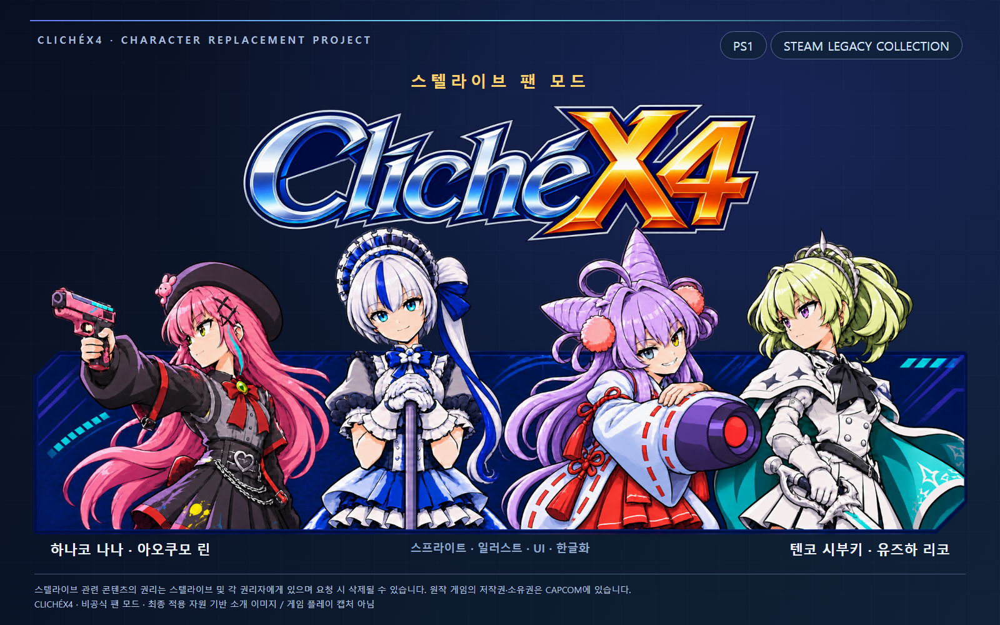
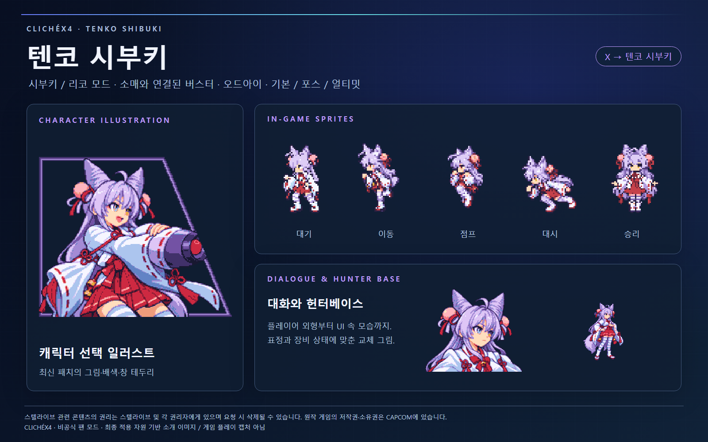
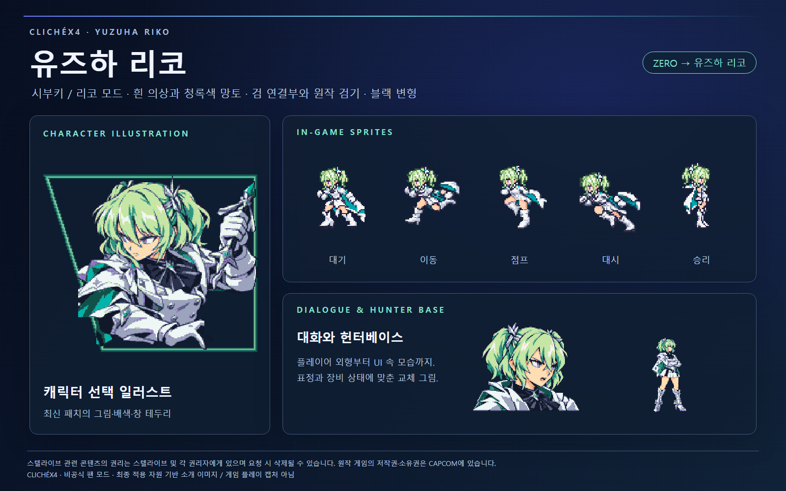
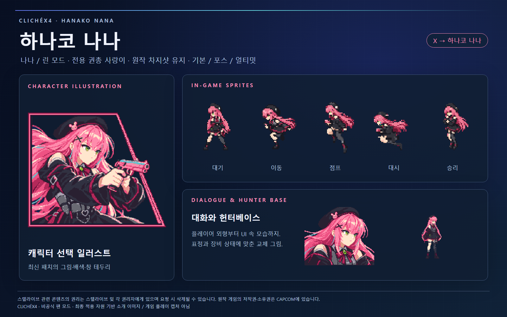
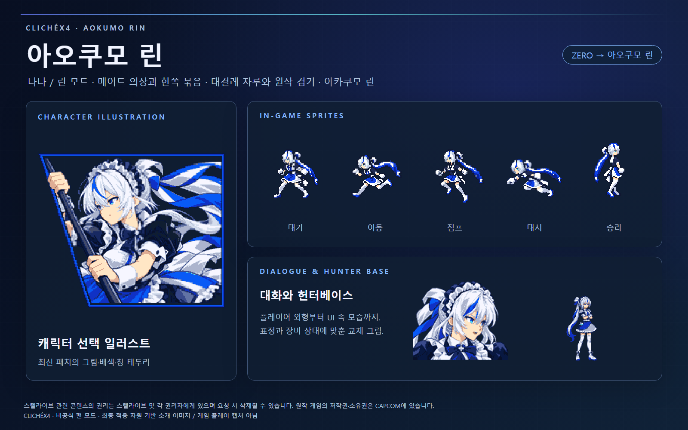

# ClichéX4 · 스텔라이브 팬 모드

**록맨 X4의 움직임 위에, 클리셰의 네 캐릭터를.**

> [!IMPORTANT]
> **사전 공지: 이 모드 프로젝트는 일부 AI를 사용하였습니다.**

Mega Man / Rockman X4의 플레이어 스프라이트, 일러스트, UI와 대사를 교체한 비공식 팬 모드입니다. PS1 미국판과 Steam **Mega Man X Legacy Collection 1**을 지원합니다. 별도 팬게임이 아니며, 직접 보유한 지원 버전의 원본 게임이 필요합니다.

## 두 가지 모드

| 모드 | X → | Zero → | Steam에서 선택할 판 |
|---|---|---|---|
| 시부키 / 리코 | **텐코 시부키** | **유즈하 리코** | English (US) edition |
| 나나 / 린 | **하나코 나나** | **아오쿠모 린** | Japanese edition |

PS1은 동일한 미국판 원본에서 두 모드를 각각 별도 BIN/CUE로 만듭니다. `ver_buki_riko`의 Buki는 이전 별칭이며, 현재 표기는 **텐코 시부키**입니다.

## 다운로드와 설치

**[Releases](https://github.com/MelissaJSM/ClicheX4/releases/latest)**에서 플랫폼에 맞는 ZIP을 받으세요. 사용 방법도 릴리스 설명에 적어 두었습니다. GitHub의 **Code → Download ZIP은 소스 자료**이며 설치용 패치가 아닙니다.

| 플랫폼 | 받을 파일 | 시작 방법 |
|---|---|---|
| PS1 | [`ClicheX4_PS1_20261110.zip`](https://github.com/MelissaJSM/ClicheX4/releases/download/release-2026-11-10/ClicheX4_PS1_20261110.zip) | 압축 해제 → `ClicheX4_PS1.exe` → 원본 BIN·모드·새 출력 폴더 선택 → 만들어진 CUE를 DuckStation 또는 ePSXe로 열기 |
| Steam | [`ClicheX4_Steam_v1.0.3_GitHub.zip`](https://github.com/MelissaJSM/ClicheX4/releases/download/release-2026-11-10/ClicheX4_Steam_v1.0.3_GitHub.zip) | 모두 압축 해제 → `ClicheX4.exe` → 패치 설치 → 모드 실행 |

**Steam판은 매번 전용 실행기의 ‘모드 실행’을 사용하세요.** Steam에서 바로 시작하면 일부 아머·일러스트·한글·효과음 실행 보정이 빠집니다. RXC1.exe 파일 자체는 변경하지 않습니다.

자세한 절차와 원본 해시: [PS1 설치](docs/INSTALL_PS1.md) · [Steam 설치·복원](docs/INSTALL_STEAM.md)

## 캐릭터 소개

### 텐코 시부키 · X 교체

여우 귀, 보라색 머리, 오드아이와 의상 실루엣을 살린 X 계열 캐릭터입니다. 소매와 연결된 버스터로 사격하며 기본형·포스아머의 개별 파츠·얼티밋 획득 전후 의상을 지원합니다.

### 유즈하 리코 · Zero 교체

흰 의상과 청록색 망토를 중심으로 구성했습니다. 손에 쥔 짧은 검 연결부를 원작 검기에 맞춰 표현합니다. 블랙 변형은 검은 외투와 흰 안쪽 의상으로 바뀝니다.

### 하나코 나나 · X 교체

전용 권총 **사랑이**를 손에 쥐고 발사합니다. 메뉴의 이름과 아이콘도 사랑이에 맞췄으며, 원래 탄환·차지샷·공격 이펙트는 유지합니다. 기본형·포스 파츠·얼티밋 획득 전후 의상을 지원합니다.

### 아오쿠모 린 · Zero 교체

흰 머리와 파란 포인트, 정돈된 한쪽 묶음과 메이드 의상을 반영했습니다. 대걸레의 짧은 자루를 원작 검기에 연결하는 방식으로 빠른 공격을 표현하며, 블랙 변형은 **아카쿠모 린**입니다.

소개판의 도트·대화 그림은 실제 패치 자원에서 복원한 이미지입니다. 소개판 자체는 게임 플레이 캡처가 아닙니다.

## 포함한 작업

- 대기·이동·점프·대시·벽·사다리·공격·특수 기술·피격·등장·승리·귀환·탑승 스프라이트
- 포스아머 부분 파츠와 풀세트, 얼티밋 획득 전 재킷 / 획득 후 수영복, 블랙 변형
- 캐릭터 선택·대화·헌터베이스·일시정지·저장·기술 획득 일러스트와 캐릭터별 UI
- X4 대사·메뉴·로딩 문구 한글화, 풀네임/호칭 구분, 원작 READY 유지
- 주인공 게임 내 보이스 무음, 효과음 보완, 누락 보스·NPC 보이스 보완, ClichéX4 타이틀 콜
- Steam 컬렉션의 X4 로고·네 캐릭터 배너·좌우 배경

게임 동영상과 영상 속 음성, 컬렉션 전체 메뉴의 언어는 교체하지 않습니다. 원작의 이동·공격 판정과 애니메이션 타이밍을 기본으로 유지합니다. [확인 범위와 제한](docs/VALIDATION.md)

## 소스와 제작 자료

| 폴더 | 내용 |
|---|---|
| [`platforms/ps1`](platforms/ps1) | 원본 보존·해시 검증을 수행하는 PS1 패처와 테스트 |
| [`platforms/steam`](platforms/steam) | Steam 설치·복원·실행기, 7종 런타임 보정과 설정 |
| [`assets/characters`](assets/characters) | 네 캐릭터의 최신 스프라이트·편집용 인덱스 레이어·의상별 일러스트 |
| [`assets/branding`](assets/branding) | 수용된 ClichéX4 로고·배너·좌우 일러스트 |
| [`assets/showcase`](assets/showcase) | README 대표 이미지와 캐릭터 소개판, 편집 가능한 HTML |
| [`development`](development) | PS1/Steam 포맷 처리·제작·검증·MIPS/x86 보정의 개발 이력 소스 |
| [`tools`](tools) | 최신 완성본에서 자산을 다시 추출하는 도구 |

[자산 안내](docs/ASSETS.md) · [빌드와 개발 안내](docs/DEVELOPMENT.md) · [구현 구조](docs/ARCHITECTURE.md) · [수정 경험과 검수 기준](docs/PRODUCTION_NOTES.md)

완성 자산은 현재 BIN의 해시와 연결되어 있습니다. 개발 이력에는 중간 버전·폐기된 실험도 있으며, 전부 최신 빌드 명령은 아닙니다. 과거 원화/임시 추출물 없이 모든 제작 이력을 한 명령으로 재현하는 구성은 아닙니다. [재현 가능한 범위](docs/DEVELOPMENT.md)를 먼저 확인하세요.

## 버그 제보

[이슈 양식](.github/ISSUE_TEMPLATE/bug_report.md)에 플랫폼, 모드, 배포 버전, 장비/파츠 상태, 재현 동작을 적어주세요. 스크린샷은 도움이 됩니다. 원본 게임·BIOS·개인 저장 데이터는 첨부하지 마세요.

## 권리 안내

**이 팬 모드에 사용된 스텔라이브 캐릭터·명칭·관련 콘텐츠의 저작권과 권한은 스텔라이브 및 각 권리자에게 있으며, 권리자의 요청 시 삭제될 수 있습니다.**

**오리지널 게임 Mega Man / Rockman X4 및 Mega Man X Legacy Collection의 저작권과 소유권은 CAPCOM에 있습니다.**

본 프로젝트는 비공식 팬 모드이며 스텔라이브 또는 CAPCOM의 공식 제품·공식 승인 배포가 아닙니다. 소스 공개나 차이 패치 제공이 원작 게임·캐릭터의 권리를 양도하는 것은 아닙니다. 원본 ROM/BIN, BIOS, 사용자 설정화 원본과 저장 파일은 포함하지 않습니다.

전체 고지: [NOTICE.md](NOTICE.md) · [소스와 자산의 이용 조건](LICENSE.md) · [제3자 구성 요소](third_party/THIRD_PARTY.txt)
