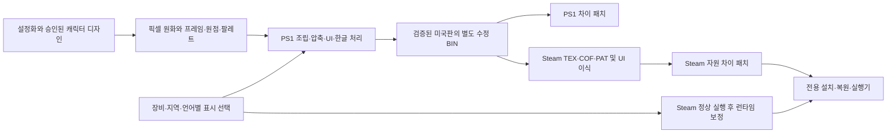

# 두 플랫폼의 구현

PS1과 Steam은 같은 픽셀 원화를 재사용하지만 실행 코드와 자원 포장은 다릅니다. PS1의 MIPS 코드를 Steam x86에 그대로 복사하지 않았습니다. 부분 아머·얼티밋·블랙 배색·대화 글자·지역별 자원 선택을 각각 구현했습니다.

## PS1

원시 섹터의 사용자 데이터·EDC/ECC를 보존하며 필요한 영역만 바꿉니다. 출력 길이와 파일 위치를 검증합니다. 몸체는 압축 이미지·팔레트·타일 조립·애니메이션 표가 분리되어 있으므로 한 PNG가 전체 동작 한 개와 일대일 대응한다고 가정하지 않습니다.

일반/블랙 Zero는 같은 비트맵을 사용합니다. X의 포스 파츠는 레이어를 합성하며, 얼티밋 의상은 현재 수용된 전/후 정책으로 선택합니다. 일러스트에는 별도의 장비 상태 선택 코드와 자원 로더가 있습니다. 수정된 BIN의 효과·대사·음향까지 전체 결과를 차이 패치로 보존합니다.

## Steam

영문판은 시부키/리코, 일본판은 나나/린에 배정합니다. 일부 공유 스테이지/HQ 자원은 모드 전용 사본으로 분리합니다. ARC는 원작처럼 디렉터리와 실제 압축 스트림 순서를 맞춥니다. TEX 변환은 팔레트·UV·투명도·반투명 정보를 따릅니다.

디스크의 RXC1.exe는 원본 상태로 둡니다. 정상 Steam 기동 후 타이틀/한글, 초상화 지역/장비 경로, 얼티밋 표시, 메뉴 의상, 오디오, 사망 효과 선택에 필요한 7종 보정을 연결합니다. 대상 바이트와 파일 해시가 예상과 다르면 적용하지 않습니다. Steam 인증을 대체하거나 우회하는 실행기가 아닙니다.

## 검증 구분

바이트 왕복·픽셀 복원·정적 합성·Unicorn의 네이티브 코드 검사·실제 플레이·사용자 확인은 서로 다른 증거입니다. 정지 모음집에서 정상인 그림만으로 모든 애니메이션·무기·장비의 실기 무결함을 주장하지 않습니다.
